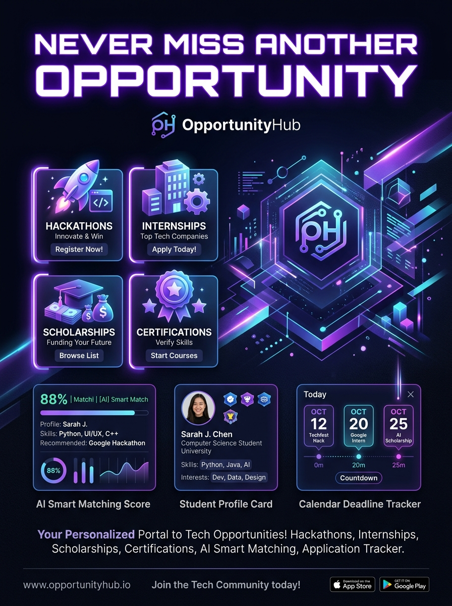
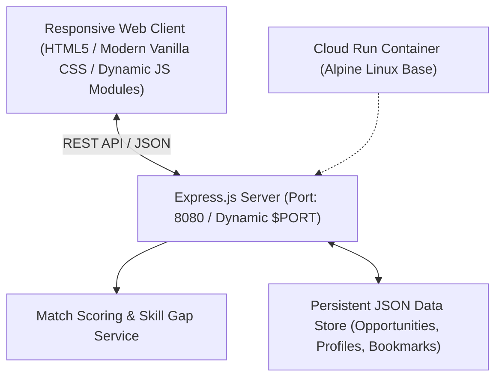

# ⚡ SkillBridge — Student Opportunity Discovery & Application Hub

[](https://nodejs.org)
[](https://expressjs.com)
[](https://cloud.google.com/run)
[](LICENSE)

> A student-first platform to discover, filter, and track verified **hackathons, internships, scholarships, certifications, and workshops** matched to your skills, degree, and career interests.

---

## 📌 Promotional Project Poster

<p align="center">
  
</p>

---

## 💡 Why We Built This
As college students, we kept missing out on great opportunities—like Google Summer of Code, major hackathons, paid internships, and scholarships—simply because information is scattered across university email inboxes, Discord servers, LinkedIn feeds, and group chats. Deadlines slip past, eligibility criteria are hard to parse, and there's no single place that matches opportunities to what you actually know or want to learn.

## 🚀 What SkillBridge Does
**SkillBridge** solves this by centralizing student opportunities into a clean, searchable dashboard:
1. **🎓 Student Profile**: Add your major, current technical skills (Python, React, Cloud, etc.), and career interests.
2. **🎯 Transparent Skill-Match Scoring**: Every listing gets a 0–100% match score with clear explanations showing which of your skills matched and what skills you can learn next.
3. **🔎 Instant Multi-Category Filters**: Filter across Hackathons, Internships, Scholarships, Certifications, and Workshops by mode (Remote, Hybrid, In-Person) and fee (100% Free).
4. **📋 Application Tracker**: Track applications across stages (*Saved → Applied → Interviewing → Accepted*) with personal notes and reminders.
5. **⏰ Approaching Deadlines & Calendar Sync**: 1-click export to Google or Apple Calendar (.ics) and a 90-day deadline countdown.
6. **💡 In-Demand Skills Radar**: Highlights skills frequently requested in active listings so you know what to focus on next.
7. **➕ Community Contributions**: Students and campus leads can submit new verified opportunities via the contribution modal.

---

## 🌐 Live Deployed Application Link
- **Platform**: Google Cloud Run
- **Live URL**: `[Insert your Google Cloud Run service URL here after running deploy script]`
- **Local Review**: `http://localhost:8080`

*(See [Google Cloud Run Deployment](#-google-cloud-run-deployment) below for instructions to launch your instance in under 2 minutes).*

---

## 💻 Tech Stack & Architecture



- **Backend**: Node.js (v22/v24), Express.js, CORS.
- **Frontend**: Responsive Single-Page Application (HTML5, Vanilla Modern CSS with Glassmorphism, Dark/Light theme switch, ES6+ modules).
- **Match Engine**: Deterministic multi-factor scoring (Skill overlap 45%, Category preference 25%, Interest alignment 20%, Education eligibility 10%).
- **Containerization**: Multi-stage Dockerfile optimized for Google Cloud Run with `/health` checks.

---

## 🛠️ Local Setup & Quickstart

### Prerequisites
- [Node.js](https://nodejs.org/) v18.0.0 or higher
- [npm](https://www.npmjs.com/) v9.0.0 or higher

### 1. Clone the Repository
```bash
git clone https://github.com/YOUR_USERNAME/skillbridge.git
cd skillbridge
```

### 2. Install Dependencies
```bash
npm install
```

### 3. Run the Development Server
```bash
npm start
```
The application will start on `http://localhost:8080`.

### 4. Run the Verification Tests
To run unit tests on the recommendation algorithm and skill-gap engine:
```bash
npm test
```

To run end-to-end API integration tests:
```bash
node tests/e2e_api_check.js
```

---

## ☁️ Google Cloud Run Deployment

SkillBridge is designed and verified to run seamlessly on **Google Cloud Run** using a single container.

### Option A: Using the Automated Script
#### On Linux / macOS / Google Cloud Shell:
```bash
chmod +x deploy-cloudrun.sh
./deploy-cloudrun.sh
```

#### On Windows PowerShell:
```powershell
.\deploy-cloudrun.ps1
```

### Option B: Using Google Cloud SDK CLI directly
```bash
# 1. Authenticate with Google Cloud
gcloud auth login

# 2. Set your active Project ID
gcloud config set project YOUR_PROJECT_ID

# 3. Enable Cloud Run and Cloud Build APIs
gcloud services enable run.googleapis.com cloudbuild.googleapis.com

# 4. Deploy directly from source directory
gcloud run deploy skillbridge \
    --source . \
    --region us-central1 \
    --platform managed \
    --allow-unauthenticated \
    --port 8080
```
Upon completion, the command line outputs your public service URL:
```
Service URL: https://skillbridge-xxxxx-uc.a.run.app
```

---

## 🔌 API Reference

| Endpoint | Method | Description |
| :--- | :--- | :--- |
| `/health` | `GET` | Container health check for Cloud Run uptime monitoring. |
| `/api/opportunities` | `GET` | List opportunities with search query, category, mode, free filter, and dynamic match scores. |
| `/api/opportunities/:id` | `GET` | Get single opportunity with detailed match breakdown and saved tracker status. |
| `/api/opportunities` | `POST` | Submit a new student opportunity to the catalog. |
| `/api/profile` | `GET` | Retrieve the active student profile. |
| `/api/profile` | `PUT` | Update student profile skills, interests, and categories (triggers live re-scoring). |
| `/api/profile/reset` | `POST` | Reset profile back to standard demo student data. |
| `/api/bookmarks` | `GET` | List all saved opportunities and application statuses. |
| `/api/bookmarks` | `POST` | Save or update application tracker status (`Saved`, `Applied`, `Interviewing`, `Accepted`). |
| `/api/bookmarks/:id` | `DELETE`| Remove opportunity from student dashboard. |
| `/api/dashboard` | `GET` | Summary metrics, approaching deadlines, in-demand skill gaps, and category stats. |

---

## 📱 Social Media & Deliverables
- **Project Poster**: Located at [`poster.jpg`](poster.jpg)
- **LinkedIn / Instagram Post Copy**: Located at [`SOCIAL_POST.md`](SOCIAL_POST.md)

---

## 📄 License
This project is licensed under the MIT License - see the [LICENSE](LICENSE) file for details.
